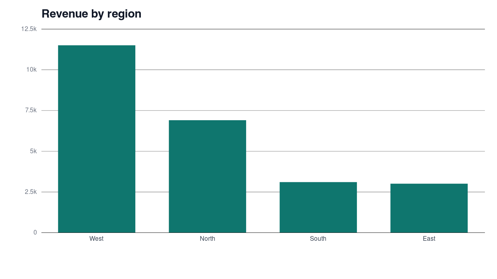

# July sales: first-week report

**Summary.** Revenue for 1–5 July was **$24,500** across four regions. West produced 47% of it. One East row has no unit count and should be fixed before forecasting.

## Findings

1. West led with $11,500 from three reported days.
2. Gizmo sold only 24 units but brought in $6,000.
3. East reported a Widget sale with *no units*, recorded as `$0.00`.

## Revenue by region

| Region | Revenue | Days reported |
| --- | --- | --- |
| West | $11,500 | 3 |
| North | $6,900 | 3 |
| South | $3,100 | 2 |
| East | $3,000 | 2 |

## Next steps

- Ask the East lead to correct the empty row
  - then rerun `office.mjs profile`
- Keep West weekend staffing

> Data: examples/sales.csv. Method: [office.mjs pivot](https://github.com/codewhale-hq/codewhale-plugin-marketplace).
